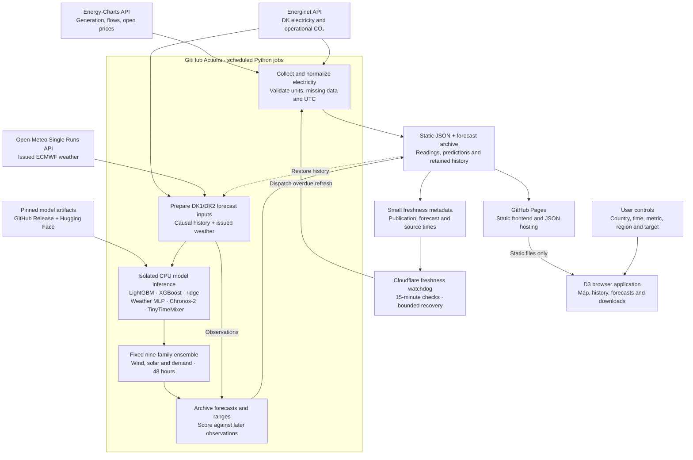

# Open Current

**Europe’s electricity, connected.** An independent electricity explorer built from public, unauthenticated APIs, with a static website and a scheduled Python data pipeline.

[Explore Open Current](https://huayuansong.github.io/open-current/)

## What you can explore

- A freely pannable, continuously zoomable map of Europe, with renewable share, low-carbon share and net imports.
- Reported generation and physical border flows for 34 configured countries, where available. Countries with missing or incomplete readings stay explicitly unavailable.
- Seven days of country history, a historical map slider, playback, and generation/demand, generation-share and price charts.
- Day-ahead wholesale prices for **15 explicitly open bidding zones**, including DK1 and DK2. Country subdivisions remain separate; a zone is never presented as a national average.
- Energinet’s preliminary five-minute power and operational consumption-CO₂ readings for West and East Denmark.
- Experimental 48-hour wind, solar and demand forecasts for DK1/DK2, with saved forecast-versus-observed comparisons and accuracy measured after issue.
- Optional 80%-target prediction ranges with measured coverage (solar: daylight only), plus internally audited demand explanations for the LightGBM component. See the [range and SHAP checks](research/forecasting/uncertainty/README.md).
- Shareable views, downloadable country JSON, source attribution, and a full methodology panel.

This is an open-data exploration, not a globally complete Electricity Maps replacement. It does **not** estimate European consumption-based carbon intensity or trace the carbon content of imports. Domestic low-carbon generation shares and Danish operational CO₂ have different meanings and are presented separately.

## Run locally

Python 3.9+ and a modern browser are sufficient. The app has no npm dependencies to install; D3 and the fonts are vendored locally.

```sh
python3 -m http.server 4322 --bind 127.0.0.1 --directory dist
```

Open http://127.0.0.1:4322/ . The repository includes a real seven-day initial snapshot.

To collect a fresh week (roughly 18 minutes due to provider rate limits):

```sh
python3 -u scripts/fetch.py --days 7
python3 scripts/normalize.py
```

A smaller refresh:

```sh
python3 -u scripts/fetch.py --days 1 --countries dk de se no
python3 scripts/normalize.py
```

All upstream requests are unauthenticated. No source API keys, tile-server keys or paid services are needed. Prices outside the explicit public-reuse allowlist are never requested.

## Architecture



The browser calls only this site's static assets. It never makes an upstream electricity API request. This respects [Energinet's shared-collection guidance](https://www.energidataservice.dk/guides/api-guides) and avoids multiplying API traffic by visitor count.

The ensemble forecasts **wind, solar and demand for DK1/DK2**, hourly for 48 hours.
Its nine candidates are the frozen original baseline, LightGBM tree control,
ridge, improved LightGBM, XGBoost, zero-shot and adapted Chronos-2, and two
TinyTimeMixer variants. The original baseline includes weather-MLP blends for
DK1 wind and DK2 solar. Frozen weights vary across the six region/target series
and leads **1–6, 7–24 and 25–48 hours**. Scheduled jobs perform inference, not training.

Forecast charts plot hourly averages at the end of each hour; tooltips show the
covered interval. A faint dotted transition guide joins consecutive observed
and forecast hours only when both values are available. It adds no forecast
values or prediction ranges and leaves missing-data gaps open.

Prediction ranges use mature out-of-sample errors; issued values and bounds are
saved rather than recalculated retrospectively. The separate
[prospective trial](forecast/trial/README.md) records challengers and outcomes in
its own ledger without automatically replacing this production ensemble.

- `scripts/fetch.py`: three independent queues (generation, physical flows, licensed prices), followed by the faster Energinet feeds; requests paced at least 31 seconds apart per Energy-Charts endpoint; retries honour `Retry-After`.
- `scripts/normalize.py`: source-unit checks, explicit generation classification, missing-value preservation, historical revision merging, sorted UTC timestamps, compact map summaries.
- `scripts/restore.py`: recovers previous published rolling history before refreshes. Deployments do not commit every data update to Git history.
- `dist/model.js`: testable time selection and missing-value rules.
- `dist/app.js`: D3 geographic projection, continuous zoom/pan, country panels and charts.
- `forecast/`: CPU inference of a fixed ensemble, issued-weather inputs, persistent forecast archive and prospective error scoring. See the [serving documentation](forecast/README.md) and [held-out research results](research/forecasting/v2/RESULTS.md).
- `dist/forecasts.js`: the forecast panel, region/target controls, interactive outlook and comparisons.
- `.github/workflows/pages.yml`: scheduled collection and Pages artifact deployment.

## Data semantics

**Generation:** Energy-Charts `v2/public_power`, in MW. We sum only explicitly classified generation series. Load, residual load, percentage indicators, trading and storage consumption are not generation. Public-generation coverage differs between countries; this is not a harmonized census of all behind-the-meter production.

**Renewables:** wind, solar, natural hydro, biomass, geothermal and reported other renewables. **Low-carbon:** those sources plus nuclear. Pumped-storage and battery discharge are displayed separately and excluded from shares because their charging mix is unknown. Waste and unspecified generation remain in the denominator, with no assumed renewable fraction. These calculated shares can therefore differ from the provider's renewable-share series.

**Missingness:** one missing generation component makes the corresponding total and share unavailable. Missing storage alone does not invalidate the primary-generation share. Unknown new series fail normalization for that feed, retaining previous valid history. A genuine zero remains zero.

**Exchanges:** Energy-Charts `v2/cbpf`, converted from GW to MW. Positive means imports. A selected country's physical-flow report is shown without combining it with a neighbour's potentially asynchronous report. Net imports are computed only if all reported border components are present. These arrows are schematic, not transmission-line geometries. Neighbours outside the configured explorer remain in the flow list and net total, even when no map arrow can be drawn.

**Time:** all displayed times are UTC. ISO offsets are respected during the autumn repeated hour. The timeline selects an hour and shows the last reading within it. It never carries a stale observation into a missing hour. Each feed retains its independent source timestamp. Generation and exchange observations in the future are rejected; published day-ahead prices may extend into tomorrow.

**Denmark:** `ElectricityProdex5MinRealtime` and `CO2Emis`, with source UTC timestamps explicitly interpreted as UTC. CO₂ is Energinet's preliminary operational consumption intensity in g CO₂/kWh, not lifecycle g CO₂e/kWh. Great Belt exchange enters each area's derived load; `BornholmSE4` is excluded because Energinet already includes it in `ExchangeSweden`. Real-time estimates can contain uncorrected errors.

**Prices:** EUR/MWh, day-ahead wholesale, excluding taxes and retail charges. The displayed current price expires at the end of its source interval. Only CC BY 4.0 responses for the allowlisted zones are retained. No private/internal-use-only price series are published.

## Automation and hosting

GitHub Pages must be configured with **GitHub Actions** as the publishing source. The workflow publishes on pushes to `main`, refreshes at minutes 7 and 37 of each hour, and supports manual refreshes. Concurrent runs are serialized. A code-only push restores the latest deployed electricity snapshot and refreshes the forecast inputs.

Forecast inference runs in GitHub Actions on CPU; Pages serves the resulting JSON. It uses the development-selected blend of tree, linear, weather MLP, Chronos-2 and TinyTimeMixer models, with frozen weights and no scheduled retraining. Two isolated Python 3.12 environments keep model dependencies compatible. An immutable, checksummed GitHub Release stores model weights, and the published site preserves 35 days of issued forecasts across runner cache eviction. Models refresh only when a new source hour or weather run is available. Failed updates keep the previous forecast and its original issue time.

Standard hosted runners are free for public repositories within applicable GitHub terms. The data pipeline uses the automatically provided GitHub deployment token; source APIs require no credentials. Artifacts expire after one day, the website retains seven days of data, and asset filenames in HTML are fingerprinted to prevent stale UI caching.

After deployment, the workflow verifies the public `health.json`, `index.json`,
`forecasts.json` and `denmark.json` against SHA-256 checksums recorded before
upload. It checks up to seven times, 30 seconds apart, to allow publication to
propagate. If publication fails or the files still differ, it waits one minute
and republishes the same artifact **once**, without repeating collection or model inference, then
checks again. A persistent mismatch fails the workflow. This verifies that the
runner can retrieve the intended snapshot; it does not make old upstream
readings fresh or guarantee propagation to every CDN location simultaneously.

GitHub's scheduler is best effort, so collection can be delayed or skipped. Public-repository schedules can be disabled after **60 days of repository inactivity**; if this happens, re-enable the workflow in Actions. The site marks delayed readings and warns when the prepared snapshot is over two hours old. It remains readable during upstream outages. Keep an eye on failed runs: this is not a guaranteed real-time service.

An independent [Cloudflare watchdog](watchdog/README.md) checks publication every
15 minutes and can dispatch the existing refresh when the snapshot is over an
hour old. It preserves a seven-day check history, prevents duplicate launches,
limits retries, and reports forecast and upstream freshness separately. Freshness
alerts appear as failed GitHub Actions runs; email delivery follows your GitHub
notification settings. It needs its own deployment and a repository-scoped
GitHub token. The original half-hourly GitHub schedule remains enabled.
The [live monitoring status](https://open-current-watchdog.naermad.workers.dev/status)
and [check history](https://open-current-watchdog.naermad.workers.dev/history)
are public; recovery controls require authentication.

## Validation

The full Python suite needs the forecasting environment. On Linux with Python 3.12, install it with `bash forecast/setup.sh`; viewing the static site needs no ML dependencies.

```sh
.cache/forecast-serving/main-env/bin/python -m unittest discover -s tests -p 'test_*.py' -v
node --test tests/*.test.mjs
```

Browser checks (optional local dependency):

```sh
python3 -m pip install playwright
python3 -m playwright install chromium
python3 tests/browser_suite.py
```

Set `GRID_TEST_URL` to test the deployed site. Checks cover the user journeys, desktop/mobile overflow, fractional zoom, panning, country and metric changes, historical time selection, price zones, chart interaction, accessible source dialog and downloads.

The suite starts a local server and runs the main explorer, forecast panel and
fixture-based regressions for interrupted loads, refresh recovery, price expiry
and empty forecast comparisons. Set
`PLAYWRIGHT_EXECUTABLE_PATH` to use an existing Chrome/Chromium executable.

The [November 2026 code review](docs/code-review-2026-11-01.md) records the fixes,
before/after parity checks and a deferred observation-provenance issue in the
separate prospective trial.

## Attribution and licences

- [Fraunhofer ISE / Energy-Charts.info](https://api.energy-charts.info/): generation and flows, CC BY 4.0. Open price feeds originate from Bundesnetzagentur / SMARD.de under CC BY 4.0. Responses are transformed and aggregated.
- [Energinet / Energi Data Service](https://www.energidataservice.dk/terms-and-conditions): Danish power and CO₂, CC BY 4.0. We normalize timestamps and derive wind shares and area demand.
- [Open-Meteo / ECMWF IFS](https://open-meteo.com/en/docs/single-runs-api): issued weather forecasts, CC BY 4.0 data; the free endpoint is used within its non-commercial usage limits.
- [Amazon Chronos-2](https://huggingface.co/amazon/chronos-2) and [IBM Granite TinyTimeMixer](https://huggingface.co/ibm-granite/granite-timeseries-ttm-r2): Apache-2.0 pretrained models, with locally trained adaptations. Licence and attribution notices are included in the model release.
- [Natural Earth](https://www.naturalearthdata.com/about/terms-of-use/): public-domain 1:50m geographic boundaries, version 5.1.2. Boundaries do not imply a position on territorial disputes.
- [D3 7.9.0](https://d3js.org/): ISC licence; vendored licence in `dist/vendor/d3-LICENSE`.
- D-DIN: SIL Open Font License 1.1; font notices in `dist/fonts/`.
- Project code: MIT. Data and third-party assets retain their respective licences.

Independent project; not affiliated with or endorsed by the data providers or Electricity Maps.

