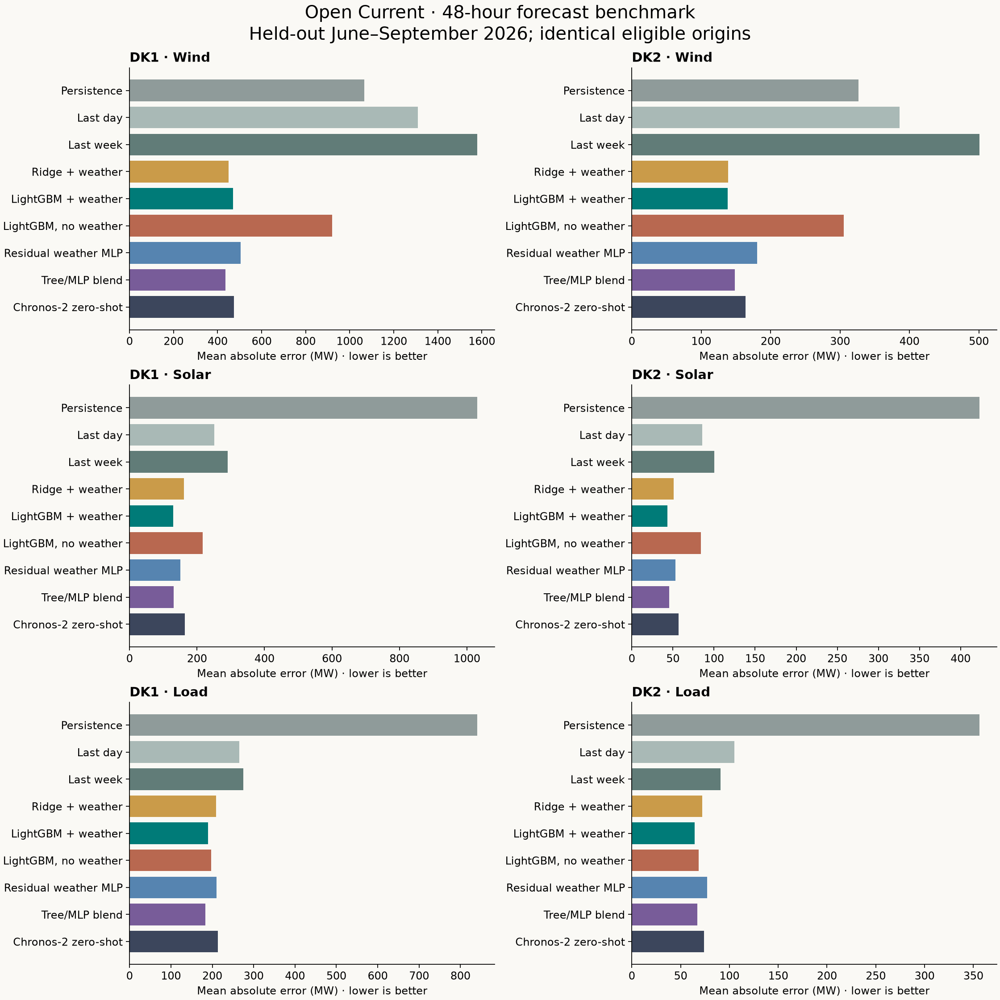
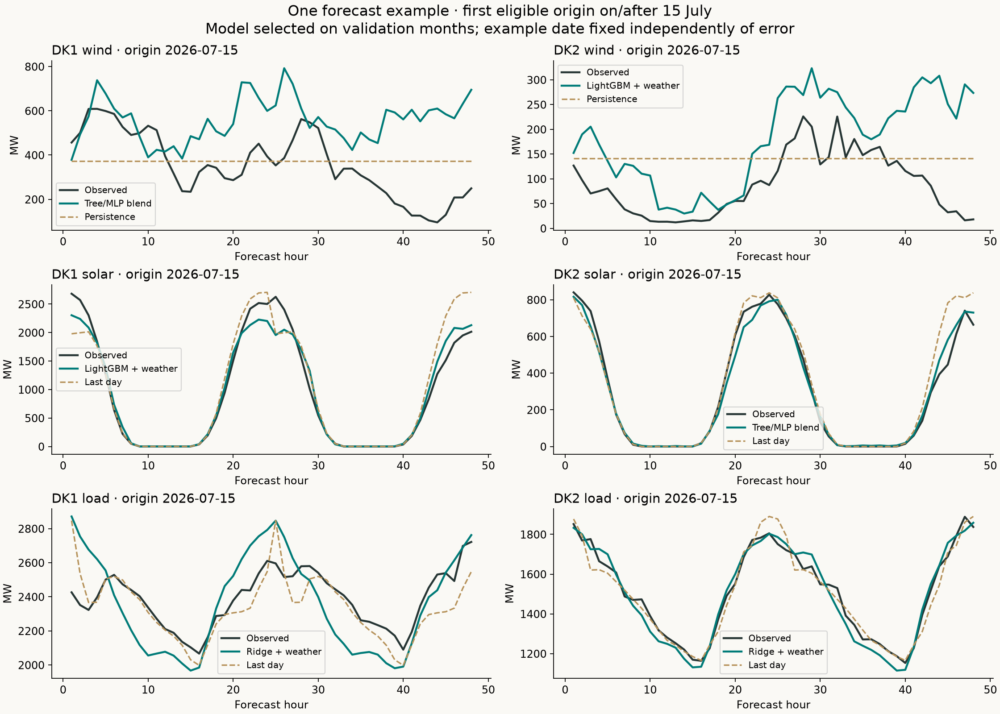

# Local forecasting results

Generated from saved predictions; no deployment or repository push.

See [research review](RESEARCH.md) and [frozen protocol](PROTOCOL.md).

## Interpretation

The strongest practical starting point is a small family of weather-informed models: boosted trees for renewables, a compact tree/neural blend where validation supports it, and a calendar/weather regression for load. The tested Chronos-2 configuration did not win model selection. Its inference was still fast enough that CPU cost alone is not a reason to reject foundation models.

Weather had a large effect on wind/solar accuracy. For load, adding weather to the tree model improved test MAE by only about 4–6%; the larger gains over naive forecasts also reflect calendar and history modeling. Validation favored ridge for load, while trees/blends did better in the summer test. That seasonal ranking change argues for rolling evaluation before deployment, rather than choosing a new winner using this already-inspected test.

Point forecasts are promising; uncertainty is less mature. Some calibrated tree intervals under-covered substantially, especially DK1 wind. Do not present these as reliable 80% bands yet. Calibration retained only 28 origins per area after completeness checks.

## Validation-selected models on the untouched test

The model and baseline were chosen using January–March validation. These are not hindsight test winners.

| Area | Target | Selected model | Test MAE (MW) | Baseline MAE (MW) | MAE reduction | 95% week-block bootstrap interval |
|---|---|---|---:|---:|---:|---:|
| DK1 | wind | Tree/MLP blend | 436.4 | 1065.6 (Persistence) | 59.0% | 54.3–62.8% |
| DK1 | solar | LightGBM + weather | 129.3 | 251.0 (Last day) | 48.5% | 43.8–52.7% |
| DK1 | load | Ridge + weather | 209.2 | 265.6 (Last day) | 21.2% | 13.9–28.0% |
| DK2 | wind | LightGBM + weather | 138.3 | 326.7 (Persistence) | 57.7% | 50.8–63.5% |
| DK2 | solar | Tree/MLP blend | 45.5 | 85.8 (Last day) | 47.0% | 40.9–52.4% |
| DK2 | load | Ridge + weather | 72.3 | 104.9 (Last day) | 31.1% | 25.2–36.0% |

## Did weather help the boosted trees?

Each ablation has its own validation-selected setting, using identical origins and lag/calendar inputs.

| Area | Target | Weather MAE | No-weather MAE | Reduction |
|---|---|---:|---:|---:|
| DK1 | wind | 470.5 MW | 919.8 MW | 48.8% |
| DK1 | solar | 129.3 MW | 216.1 MW | 40.2% |
| DK1 | load | 189.9 MW | 197.0 MW | 3.6% |
| DK2 | wind | 138.3 MW | 305.4 MW | 54.7% |
| DK2 | solar | 43.6 MW | 84.0 MW | 48.2% |
| DK2 | load | 64.4 MW | 68.5 MW | 6.0% |

## Intervals need empirical checking

These are nominal 80% prediction intervals. Coverage is measured on test data; dependent observations and drift invalidate any automatic exchangeable-data guarantee.

| Area | Target | Interval method | Coverage | Mean width (MW) |
|---|---|---|---:|---:|
| DK1 | wind | lightgbm_raw | 54.0% | 905.4 |
| DK1 | wind | lightgbm_calibrated | 67.8% | 1136.9 |
| DK1 | wind | chronos2_raw | 80.4% | 1553.3 |
| DK1 | solar | lightgbm_raw | 54.6% | 267.2 |
| DK1 | solar | lightgbm_calibrated | 73.6% | 297.6 |
| DK1 | solar | chronos2_raw | 77.5% | 493.7 |
| DK1 | load | lightgbm_raw | 62.3% | 391.9 |
| DK1 | load | lightgbm_calibrated | 82.6% | 622.6 |
| DK1 | load | chronos2_raw | 77.2% | 669.7 |
| DK2 | wind | lightgbm_raw | 49.7% | 291.4 |
| DK2 | wind | lightgbm_calibrated | 82.6% | 444.2 |
| DK2 | wind | chronos2_raw | 79.1% | 509.9 |
| DK2 | solar | lightgbm_raw | 59.5% | 76.1 |
| DK2 | solar | lightgbm_calibrated | 84.6% | 131.8 |
| DK2 | solar | chronos2_raw | 75.0% | 166.7 |
| DK2 | load | lightgbm_raw | 50.0% | 101.2 |
| DK2 | load | lightgbm_calibrated | 79.2% | 195.5 |
| DK2 | load | chronos2_raw | 79.3% | 233.9 |

## Runtime and artifacts

- Six selected LightGBM point models: **0.0164 s** summed warm inference for both areas and all targets, **9.29 MB** serialized, **9.7 s** summed selected-model fitting. Tuning and interval models cost extra.
- Chronos-2: **0.098 s** for two area tasks/all three targets; **0.25 s** cached model load (excluding Python imports/download); **119,477,664 parameters**. Public pretrained weights, not trained locally.
- The successful full training/tuning/calibration run took **70.6 s**, excluding backfill, the separate Chronos evaluation and an earlier local runtime failure. Neural training runs in isolated processes to avoid a macOS OpenMP conflict between LightGBM and PyTorch.
- Local system: `macOS-26.6.2-arm64-arm-64bit`, Python `3.12.14`, four CPU threads per model. These timings exclude network/data preparation and are **not measurements on a GitHub runner**.
- All model settings, selected neural widths/epochs, quantile timings and model sizes are in [runtime.csv](runtime.csv), [selection.json](selection.json) and [tuning.json](tuning.json).

## Data and exclusions

- 385,194 five-minute records, 32,206 area-hours before sample exclusions, 912 eligible area-origins.
- Counts: `{"calibration/DK1": 28, "calibration/DK2": 28, "test/DK1": 88, "test/DK2": 88, "train/DK1": 273, "train/DK2": 273, "validation/DK1": 67, "validation/DK2": 67}`.
- Exclusions: `{"missing_or_invalid_electricity": 338, "missing_weather": 2, "purged": 16, "unavailable_weather_run": 8}`.
- Complete 168-hour histories and complete 48-hour labels are required. Even one missing five-minute interval can exclude several neighboring origins; these exclusions do not imply continuous multi-day outages. See [hourly coverage](data_coverage.csv). Accuracy is conditional on available data, not a claim of 100% service coverage.
- SCADA target values can contain uncorrected errors; load is derived system load including losses. The observed historical download is not a publication-vintage archive.
- One origin per day, 12 UTC completed-hour inputs with an assumed 15-minute availability buffer. Weather is that day's 00 UTC ECMWF run. This does not validate half-hourly refreshes or actual historical delivery times.
- One year of training and summer/early-autumn testing do not establish winter or pan-European performance. The small hyperparameter budget and single neural seed do not establish that an architecture cannot do better.
- This compares practical pipelines, not architecture alone: trained models use weather at three separate points per area; Chronos uses area means/spreads and jointly sees all three target histories. Different feature representations and zero-shot versus local training limit family-wide conclusions.
- Chronos checkpoint `29ec3766d36d6f73f0696f85560a422f50e8498c`; repository last modified `2026-06-05 11:55:42+00:00`. The [weight audit](chronos_weights_audit.json) confirms its weights match the 30 October 2025 release byte for byte, preceding the 2026 evaluation. The complete pretraining corpus remains unaudited.

## Inspect the forecasts

Full model/area/horizon/daylight/peak/ramp results: [metrics.csv](metrics.csv). Monthly drift: [monthly_metrics.csv](monthly_metrics.csv). Interval coverage, width and pinball: [interval_metrics.csv](interval_metrics.csv).

Saved raw data, prediction arrays and model weights are in `.cache/forecasting/` (ignored by Git). The raw-data manifest has SHA-256 checksums. No live UI, workflow or published dataset was modified.
