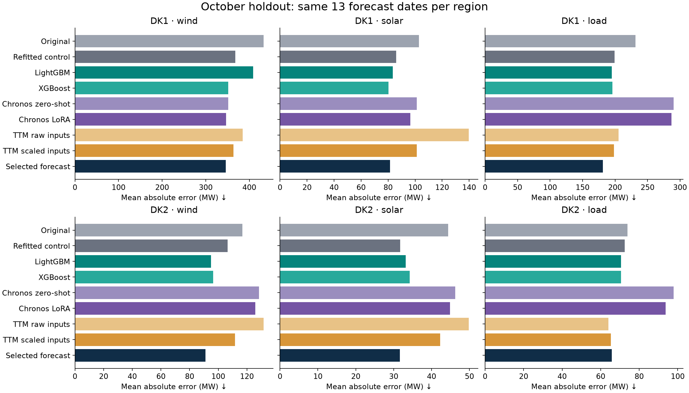
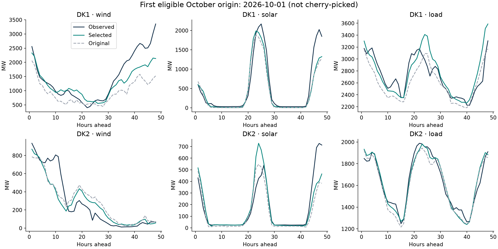

# Second forecasting experiment

All three requested rounds were trained and evaluated locally: improved
LightGBM/XGBoost, weather-conditioned Chronos-2 LoRA, and pretrained
TinyTimeMixer with a fine-tuned weather/channel-mixing head.

The forecast blend selected on development data reduced October MAE by
**11.1–28.7% versus the original frozen models** across all six area/target
combinations. Against an updated tree using the original features, improvement
was **0.3–14.5%**. Updating the training data therefore accounts for a substantial
part of the progress. These are measured results on a small autumn sample,
not a demonstrated year-round improvement.

XGBoost was competitive with LightGBM and substantially better for DK1 wind
on this holdout. Additional features did not help every tree: the updated
original-feature control beat the expanded LightGBM model on DK1 wind and
DK2 solar. Chronos LoRA modestly improved its per-location zero-shot control
on all six tasks and was the best individual model for DK1 wind. Raw-input
TinyTimeMixer was the best individual model for DK2 load; scaling improved
TTM on the other five tasks. The selected blend had the lowest holdout error
on four tasks; XGBoost won DK1 solar and TTM won DK2 load. The frozen selection
was retained instead of replacing it with these after-the-fact winners.

**Validation:** 23 temporal, artifact-integrity and existing pipeline checks,
plus three TTM preprocessing checks passed. Model save/reload and neural
future-target leakage checks also passed during the experiment. Both charts
were visually inspected. Models and results remain local.

## Fresh October holdout

Settings and ensemble weights were frozen at 2026-10-27T08:47:15.913624+00:00 before
this evaluation. The original June–September test is now development data.
October has **13 eligible dates per region**, 48 forecast hours each. The
forecasts overlap, so those hours are not independent observations.

| Area | Target | Original MAE | New MAE | New WAPE | Error reduction vs original | Gain vs refitted control |
| --- | --- | --- | --- | --- | --- | --- |
| DK1 | wind | 432.7 MW | 345.7 MW | 16.9% | +20.1% | +6.0% |
| DK1 | solar | 102.8 MW | 81.4 MW | 24.8% | +20.8% | +5.2% |
| DK1 | load | 231.3 MW | 181.2 MW | 6.0% | +21.7% | +9.1% |
| DK2 | wind | 116.9 MW | 91.2 MW | 14.4% | +22.0% | +14.5% |
| DK2 | solar | 44.4 MW | 31.6 MW | 23.3% | +28.7% | +0.3% |
| DK2 | load | 74.0 MW | 65.8 MW | 3.8% | +11.1% | +9.3% |

MAE is mean absolute error in MW. WAPE is total absolute error divided by total
observed output/load; it is not classification accuracy. Positive gains mean
less error. The refitted control uses the original tree features with updated
training data, so it is a stronger comparison than the frozen original models.

## Every candidate, including losses

All entries below are October MAE in MW. The selected forecast uses development
selection, not whichever candidate happened to win October.

| Family | DK1 wind | DK1 solar | DK1 load | DK2 wind | DK2 solar | DK2 load |
| --- | --- | --- | --- | --- | --- | --- |
| frozen | 432.7 | 102.8 | 231.3 | 116.9 | 44.4 | 74.0 |
| tree_control | 367.9 | 85.9 | 199.4 | 106.6 | 31.7 | 72.5 |
| ridge | 388.4 | 193.4 | 189.1 | 105.1 | 58.8 | 72.0 |
| lightgbm | 408.7 | 83.4 | 195.1 | 94.9 | 33.2 | 70.7 |
| xgboost | 351.8 | 80.3 | 195.9 | 96.4 | 34.3 | 70.5 |
| chronos_zero | 351.5 | 101.3 | 290.3 | 128.5 | 46.3 | 97.9 |
| chronos | 346.4 | 96.4 | 287.1 | 125.8 | 44.9 | 93.8 |
| ttm | 384.7 | 139.6 | 205.6 | 131.6 | 49.8 | 64.0 |
| ttm_scaled | 363.8 | 101.2 | 198.4 | 111.6 | 42.2 | 65.3 |
| persistence | 1231.2 | 811.2 | 824.6 | 395.0 | 325.5 | 358.5 |
| last_day | 1689.7 | 197.4 | 333.6 | 548.2 | 65.8 | 125.0 |
| last_week | 1441.9 | 222.8 | 322.7 | 599.1 | 73.1 | 104.7 |
| blend | 345.7 | 81.4 | 181.2 | 91.2 | 31.6 | 65.8 |
| selected | 345.7 | 81.4 | 181.2 | 91.2 | 31.6 | 65.8 |

Development selected **300 Chronos steps** and **40 TTM
epochs at learning rate 0.0003**. These scores average WAPE
equally across the six area/target combinations; they are not October scores.
The scaled-input TTM variant selected 40 epochs at learning
rate 0.0003; its addition during development is recorded
in the implementation notes.

| Candidate | Development mean WAPE |
| --- | --- |
| Chronos LoRA 100 steps | 20.43% |
| Chronos LoRA 300 steps | 20.19% |
| TTM raw lr/epoch 0.0001_10 | 27.80% |
| TTM raw lr/epoch 0.0001_20 | 23.52% |
| TTM raw lr/epoch 0.0001_40 | 22.07% |
| TTM raw lr/epoch 0.0003_10 | 22.82% |
| TTM raw lr/epoch 0.0003_20 | 22.00% |
| TTM raw lr/epoch 0.0003_40 | 21.80% |
| TTM scaled lr/epoch 0.0001_10 | 22.51% |
| TTM scaled lr/epoch 0.0001_20 | 20.13% |
| TTM scaled lr/epoch 0.0001_40 | 19.37% |
| TTM scaled lr/epoch 0.0003_10 | 19.33% |
| TTM scaled lr/epoch 0.0003_20 | 19.03% |
| TTM scaled lr/epoch 0.0003_40 | 18.77% |

## Local CPU cost

| Family | Final training seconds | Warm inference seconds, all six series |
| --- | --- | --- |
| tree_control | 13.1 | 0.003 |
| ridge | 0.1 | 0.001 |
| lightgbm | 17.3 | 0.003 |
| xgboost | 6.3 | 0.002 |
| chronos | 399.5 | 0.356 |
| ttm | 295.9 | 0.012 |
| ttm_scaled | 172.4 | 0.008 |

Measured on the local Mac with four CPU threads. Some training ran concurrently;
these are elapsed timings, not isolated hardware benchmarks. Inference excludes
Python imports, first model download and API requests. GitHub's Linux runners
have not been benchmarked. Tuning costs and memory are in the runtime JSON files.

## What this experiment can establish

- Two expanding validation folds: train through May for June–July; train through
  July for August–September. Labels crossing each boundary are excluded. Final
  models train on eligible labels before October. Selection is per region/target.
- Matched LightGBM/XGBoost absolute-error objectives and four configurations
  each; compare shallow/regularized vs larger trees and optional recency weights.
  Extra inputs summarize recent weather-to-output conversion and cross-target
  history. Ridge and the unchanged-feature tree are controls.
- Chronos sees the same per-location weather signals rather than the earlier
  averaged covariates. LoRA updates about 1.2 million parameters. Its fine-tuning
  keeps each forecast origin fixed. TinyTimeMixer uses 512 actual historical
  hours and freezes the pretrained backbone while training decoder/weather head.
- The convex ensemble has separate weights for 1–6, 7–24 and 25–48 hours.
  Weights and family selection reuse development predictions; the independent
  October holdout tests that decision. They are not selected on October errors.
- All future weather comes from archived model runs. Neither neural model is
  given future electricity observations as input. Reload and leakage checks run
  during training; original artifact hashes are retained.

## Limits

The small October sample does not prove a year-round improvement. Descriptive
paired calendar-week bootstrap intervals in `selected_metrics.csv` have very
few clusters and cannot establish robust statistical significance. Missing
SCADA hours exclude overlapping windows, so results are conditional on complete
input availability. Older TTM gaps are causally filled with observation masks.

Weather run publication timing is assumed, not historically timestamped. SCADA
is a later download of an operational feed, not a preserved real-time vintage;
derived system load includes losses. Weather locations remain the original six
points and are not generation-capacity weighted. This is one daily origin, not
a validation of half-hourly operation. Intervals have not been recalibrated.
Each setting has one seeded training run; the bootstrap does not measure
variation between training seeds. The original tree-versus-neural comparison
also differs in history representation (168 versus TTM's 512 hours), so this
compares practical pipelines rather than isolating architecture alone.

No models or site changes have been pushed or deployed. See [protocol](PROTOCOL.md),
[implementation notes](IMPLEMENTATION_NOTES.md), and [reproduction instructions](README.md).

Primary implementation references: [LightGBM](https://lightgbm.readthedocs.io/en/latest/Features.html),
[XGBoost](https://xgboost.readthedocs.io/en/stable/parameter.html),
[Chronos-2](https://huggingface.co/amazon/chronos-2),
[TinyTimeMixer R2](https://huggingface.co/ibm-granite/granite-timeseries-ttm-r2).
